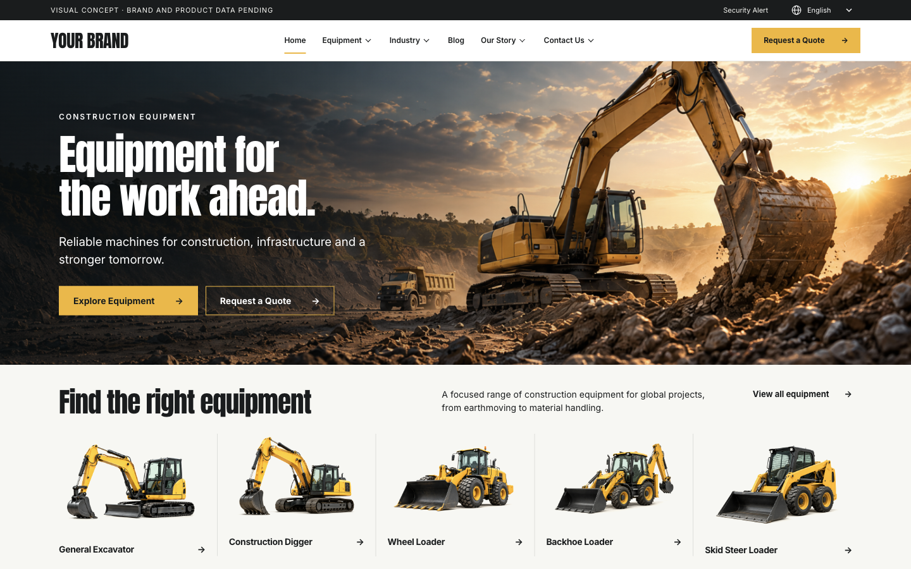

# 挖掘机 WordPress 完整本地演示站

下载后就是已填好内容的工程机械 B2B 网站：可以浏览前台、登录 WordPress CMS、编辑产品和页面，也可以让 Codex 在你的电脑里继续开发。

本项目使用 **WordPress Playground + PHP WebAssembly + SQLite**。无需准备服务器、域名、PHP、MySQL、Docker 或 WordPress 主机账号。首次启动需要联网下载运行依赖；启动脚本会在缺少合适的 Node.js 时，自动下载到项目自己的 `.tools/` 目录。

## 最简单：把链接发给 Codex

安装好 Codex 后，直接发送：

```text
请将 https://github.com/jackzhang1314/excavator-wordpress-demo 克隆到一个新文件夹，
先阅读仓库的 AGENTS.md 和 README.md，然后在我的电脑上启动完整的 WordPress 演示站。
macOS/Linux 使用 bash start.sh，Windows 使用 start.ps1。
请保持网站运行，并帮我打开前台和 WordPress 后台，告诉我演示账号。
保留预填内容和图片，后续我还要继续编辑和开发。
```

这里“安装 Codex 即可开始”指由 Codex 帮你下载项目并运行入口，所需运行环境由入口准备。电脑仍需联网，并允许下载和启动本地程序。不会替你购买主机或连接线上账号。

电脑没有 Git 时，也可以让 Codex 下载本仓库的 [ZIP 完整包](https://github.com/jackzhang1314/excavator-wordpress-demo/archive/HEAD.zip)，解压后启动，不需要 GitHub 账号。



## 启动与登录

macOS / Linux：

```bash
bash start.sh
```

Windows，在项目文件夹打开 PowerShell：

```powershell
powershell -NoProfile -ExecutionPolicy Bypass -File .\start.ps1
```

已安装 Node.js 22.13+ 的开发者，也可直接运行：

```bash
npm ci --ignore-scripts
npm start
```

| 入口 | 地址 / 账号 |
| --- | --- |
| 网站前台 | http://127.0.0.1:9400/ |
| CMS 后台 | http://127.0.0.1:9400/wp-admin/ |
| 管理员账号 | `demo_admin` |
| 管理员密码 | `ExcavatorDemo2026!` |

以上是公开的本地演示账号。服务只监听本机，不应拿这套账号直接部署公网。端口占用时运行 `bash start.sh --port 9401`、`./start.ps1 --port 9401` 或 `npm start -- --port 9401`，以终端打印的地址为准。停止时按 Ctrl+C；再次启动会保留你的修改。

## 打开后有哪些内容

- 原本地站点的完整页面、菜单、页头语言入口、预填 CMS 字段和图片；包括首页、设备总览、企业与服务页面、文章和行业方案。
- **5 个一级产品类目、10 个二级类目、20 个已发布产品、11 个行业方案、9 篇已发布文章**，75 条规划页面路径。
- 每个产品和类目原有的完整富文本 Description；图片、图库、参数、FAQ、关联内容与页面模板绑定一起保留。
- 原生 WordPress 后台，支持编辑内容、上传图片、修改菜单和查看本地询盘。

这是已完成页面结构和样式的演示内容，仍包含 YOUR BRAND、待确认型号参数和 AI 概念图片。它们是原站已有的展示资料，不能当作真实制造商资质或产品承诺。

## 你修改的内容存在哪里

首次启动把 `site/content.json` 和随附媒体导入一个全新的本地数据库。之后不会重复覆盖你的内容。

- 后台修改、后来上传的媒体和本地询盘：保存在当前项目的 `.runtime/`。
- 页面样式和模板：`site/theme/`，直接修改即可在本地刷新查看。
- 产品、类目、ACF 字段和表单业务代码：`site/plugin/`。
- 初始预填内容：`site/content.json`；它用于新副本的第一次启动。

`.runtime/` 不提交到 Git。要保留后台改动，保存或备份整个项目文件夹里的 `.runtime/`；仅重新下载仓库不会带回你自己电脑上的后续修改。换电脑时应同时迁移自己的运行数据，详见 [数据与备份](docs/DATA.md)。

## 继续开发

可以直接告诉 Codex：“基于这个项目修改首页 / 增加产品字段 / 调整某个模板，保留现有内容。”本仓库有独立的源代码、固定版本依赖和开发说明，**不依赖 WordPress Build Skill / Harness**。

先阅读 [开发说明](docs/DEVELOPMENT.md)、[数据与备份](docs/DATA.md) 和 [常见问题](docs/TROUBLESHOOTING.md)。启动后可运行 `npm run verify` 检查页面；`npm test` 检查运行入口的关键保护逻辑。

## 询盘与账号边界

表单会保存在本机的 Fluent Forms → Entries，可体验提交与后台查看。**演示不发送邮件**，没有企业邮箱、SMTP 密码、主机配置、真实询盘、线上账号、插件授权密钥或共享 Harness。第三方在线聊天、付费翻译和分析账号不随包提供。

原站免费的 GTranslate 语言切换插件与原有设置一并保留，不需要原作者账号；在线翻译需要联网，英文页面、预填内容和媒体在本地。翻译质量不在此次验收范围。

本地站不开放搜索引擎索引，不连接原来的企业服务账号；正常的 WordPress 插件管理和内容联网能力保留，自动升级关闭以保持预置版本。源码、媒体和完整内容可继续编辑。公开演示管理员密码只属于这个新建的本地副本。

## 版本与许可

WordPress 6.9.10、PHP 8.3、Playground 3.1.52，对应所打包的原本地环境。数据库在新电脑上由 SQLite 自动创建。第三方插件和字体保留各自许可证，详见 [第三方说明](THIRD-PARTY-NOTICES.md)。ACF PRO 包不包含授权密钥；现有内容字段可编辑，官方更新、支持及需授权的字段组设计功能需使用你自己的许可证。

已完成的实测范围见 [交付验证](docs/VERIFICATION.md)。
